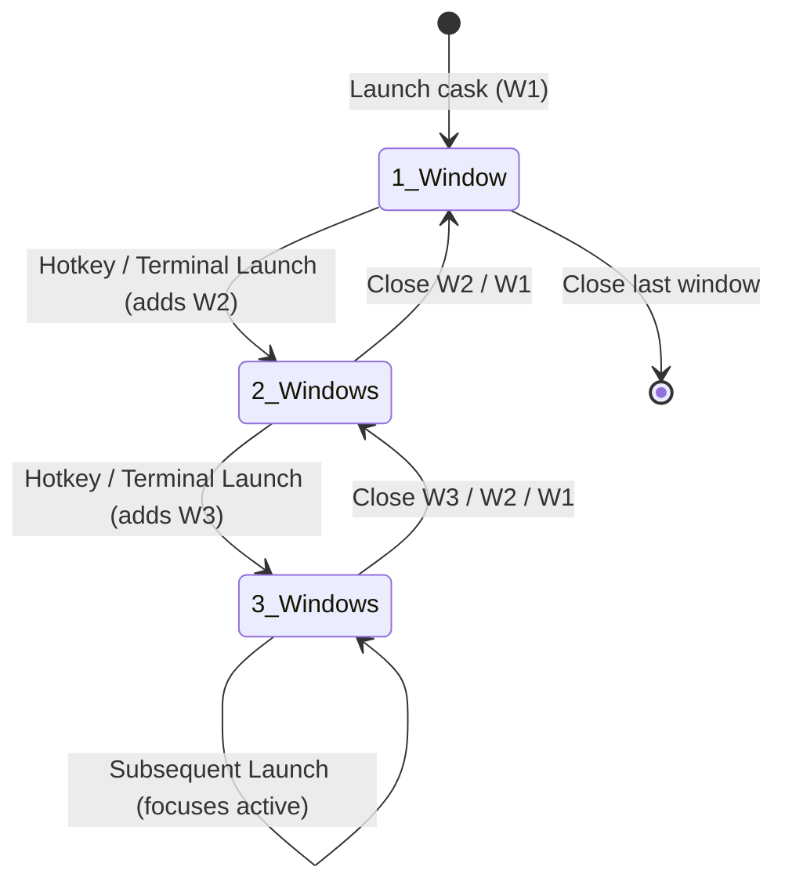
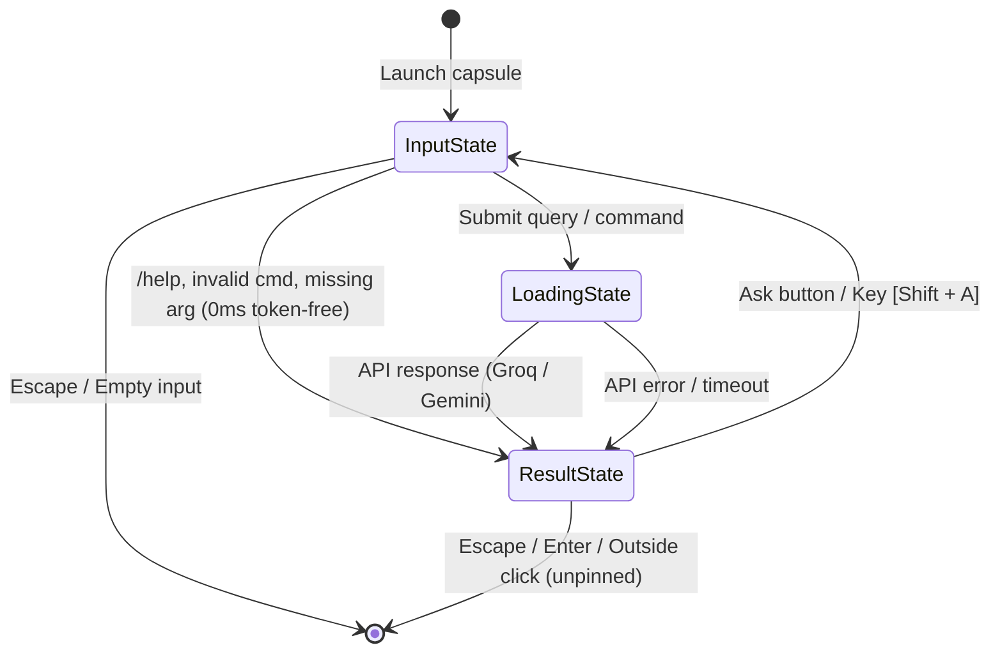

# CAsk (Universal Quick AI Assistant & Command Runner) - Technical Knowledge Base

This document details the software architecture, design principles, technical solutions, and component specifications for CAsk v2.0.

---

## 1. System Architecture & Workflow

- **Project:** CAsk (Universal Quick AI Assistant & Command Runner)
- **Version:** 2.0.0
- **Runtime:** Python 3.10+
- **UI Framework:** Native PyQt6 (Qt6 Widgets)
- **Target OS:** Linux (Fedora, Arch, Ubuntu/Debian)
- **Display Server:** Wayland (Compositor: KDE Plasma 6 / KWin, Hyprland, Sway, GNOME) & X11 fallback
- **AI Backend (Hybrid Failover):**
  - **Primary:** Groq Cloud API (default model: `openai/gpt-oss-120b` or `qwen/qwen3.8-27b`) for sub-second responses (~0.5s - 0.8s).
  - **Fallback:** Google Gemini API (`gemini-3.5-flash-lite`), automatically triggered if Groq fails, times out, or lacks an API key.
- **Network Layer:** Python standard library `urllib.request` with forced IPv4 resolution (avoiding Wayland/systemd IPv6 DNS lookup latency).
- **Execution Concurrency:** Non-blocking asynchronous Qt worker thread (`APIWorker` in `QThread`) emitting signals (`finished`, `error`) to preserve 60fps UI responsiveness.
- **Multi-Turn Conversation Engine:**
  - `core/api_client.py`: Request payloads serialize conversational `history` into Groq (OpenAI-compatible) and Gemini (`contents`) schemas.
  - `core/config.py`: Configurable `MAX_FOLLOWUP_TURNS` (default: 3, clamped 1–10).
  - `ui/capsule.py`: Thread state isolation per capsule (`_chat_history`, `_turn_count`).
  - `ui/result_view.py`: Dedicated follow-up input bar (`#FollowUpInput`), turn counter badge (`#TurnBadge`), and shortcut isolation preventing collision between letter typing and action shortcuts.
- **Decoupled System Prompts (`execution/DEFAULT.md` & `execution/commands/*.md`):**
  - All AI personas are externalized markdown files with frontmatter-style metadata.
  - `execution/DEFAULT.md` configures the default behavior when no slash command is used.
  - Modular slash commands (`ask.md`, `eva.md`, `trans.md`) dynamically populate `/help` and autocomplete dropdowns.
- **Configuration & Security:**
  - Lookup order: `~/.config/cask/config.env` -> `config.env` -> `.env`.
  - Permissions: strictly `chmod 600` (read/write by owner only).
  - Excluded from version control via `.gitignore`.

---

## 2. Multi-Window Concurrent Architecture (Up to 3 Windows)

CAsk supports up to **3 concurrent independent capsules** arranged in a horizontal grid. The layout dynamically adapts based on the active window count:



### Layout Distribution Rules:

| Active Count | Screen Width Coverage | Slot 0 (Left) | Slot 1 (Center) | Slot 2 (Right) | Description |
| :--- | :--- | :--- | :--- | :--- | :--- |
| **1 Window** | Standard (600 / 760px) | — | $W_1$ (Centered) | — | Single centered card horizontally & vertically. |
| **2 Windows** | **80% of Screen Width** | $W_1$ (50% of 80%) | — | $W_2$ (50% of 80%) | 2 cards side-by-side with equal width, centered. |
| **3 Windows** | **100% Full Screen Width** | $W_3$ (**30%**) | $W_1$ (**40%**) | $W_2$ (**30%**) | 3 cards with ratio **30 : 40 : 30**. $W_1$ stays in center. |

- **Opening Flow:** Opening $W_1$ centers it. Opening $W_2$ shifts $W_1$ to the left and adds $W_2$ to the right (80% screen). Opening $W_3$ adds $W_3$ to the far left, placing $W_1$ in the center and $W_2$ on the right (full screen 30:40:30).
- **Closing Flow:** Closing any capsule smoothly shifts remaining capsules to the corresponding $N=2$ or $N=1$ layout. Closing the last capsule exits the application.

---

## 3. Capsule Interaction Lifecycle & State Machine

Each capsule (`CAskCapsule`) operates its own isolated state machine:



### State Breakdown:

1. **State 0: Input State (`STATE_INPUT`)**
   - **Dynamic Height Auto-Expansion:** Minimum 50px (single line baseline) up to 220px (clamped max height). Automatically resizes to fit multiple lines and wrapped text.
   - **Multiline Editing:** Pressing <kbd>Shift</kbd>+<kbd>Enter</kbd> inserts a newline. Pressing <kbd>Enter</kbd> submits.
   - **Scrollbar Behavior:** Scrollbar is strictly hidden on single lines and empty text (`ScrollBarAlwaysOff`), activating as needed only when reaching 220px.
   - **Autocomplete:** Typing `/` opens a `QCompleter` dropdown displaying registered commands (`/help`, `/ask`, `/eva`, `/trans`).
   - **Focus Retention:** Persistent across focus loss; users can click background windows without dismissing the input bar.

2. **State 1: Loading State (`STATE_LOADING`)**
   - **Dimensions:** 54px height.
   - **Styling:** Semi-transparent glass capsule with animated dots and custom loading label.
   - **Focus Retention:** Persistent during background API queries; does not dismiss when user interacts with background windows.

3. **State 2: Result State (`STATE_RESULT`)**
   - **Dimensions:** Elastic height calculated from markdown document geometry (min 190px up to 840px max).
   - **Header Action Bar:**
     - **Drag Handle (`#DragHandle`):** SVG 6-dot grip icon `⋮⋮` allowing drag-and-drop window reordering with live drop preview and tooltip indicating `[Alt + ← / →]`.
     - **Status Badge:** Identifies result type (e.g. `Help`, `/ask`, `/eva`, `/trans`, `Assistant`).
     - **Ask (`#AskButton`):** SVG magnifying glass icon + `Ask` (Shortcut: <kbd>Shift</kbd> + <kbd>A</kbd>). Switches back to the input bar to refine or submit a new query.
     - **Copy (`#CopyButton`):** SVG clipboard icon + `Copy` (Shortcut: <kbd>Shift</kbd> + <kbd>C</kbd> / <kbd>Ctrl</kbd> + <kbd>C</kbd>). Copies full markdown to clipboard with temporary `✓ Copied!` confirmation.
     - **Pin (`#PinButton`):** SVG pushpin icon + `Pin` / `Pinned` (Shortcut: <kbd>Shift</kbd> + <kbd>P</kbd>). Toggles window pinning.
     - **Exit (`#ExitButton`):** SVG cross `✕` icon + `Exit` (Shortcut: <kbd>Esc</kbd>). Dismisses the card.
   - **Multi-Turn Follow-Up Footer Bar:**
     - **Follow-up Input (`#FollowUpInput`):** Translucent input bar embedded at the bottom of the card for follow-up questions within the active capsule context.
     - **Turn Counter Badge (`#TurnBadge`):** Real-time indicator displaying `(current_turn / max_turns)`.
     - **Turn Limit Enforcement:** Automatically locks input and displays guidance when reaching `MAX_FOLLOWUP_TURNS` (default 3, clamped 1–10).
     - **Shortcut Guarding:** When focused in the follow-up input bar, typing uppercase letters (<kbd>Shift</kbd> + <kbd>A</kbd>, <kbd>Shift</kbd> + <kbd>P</kbd>, <kbd>Shift</kbd> + <kbd>C</kbd>) is safely preserved without triggering window shortcuts.
   - **Window Reordering Shortcuts:** <kbd>Alt</kbd> + <kbd>←</kbd> and <kbd>Alt</kbd> + <kbd>→</kbd> swap the focused capsule with its adjacent left/right slot while preserving predefined slot geometry ratios (e.g., 30 : 40 : 30). This functions seamlessly in both the **Input Bar** (without conflicting with text selection/highlighting) and the **Result Box**.
   - **Pinning Rules:** When pinned (`is_pinned == True`), the card **cannot** be dismissed by clicking outside, pressing <kbd>Esc</kbd>, or pressing <kbd>Enter</kbd>. It can only be dismissed via the Exit button or by unpinning.

---

## 4. Technical Solutions & Wayland Optimizations

### 📌 Solution 1: Unified Window Masking for Multi-Window Precision
- **Challenge:** Under Wayland (`xdg_shell`), client applications cannot programmatically set window coordinates (`move()` / `setGeometry()` are ignored by KWin). Creating 3 separate OS-level windows causes KWin to cascade them unpredictably.
- **Solution:** A single screen-covering frameless transparent `MainWindow` orchestrates child `CAskCapsule` widgets with pixel-perfect coordinates. Using `setMask(QRegion)`, transparent spaces between and around cards are excluded from input regions, allowing clicks to pass through directly to background applications.

### 📌 Solution 2: Resolution-Independent SVG Vector Icons
- **Challenge:** Emoji characters (e.g. 📌, 🔍) frequently fail to render or show as missing glyph boxes on Linux distributions lacking emoji fonts or using monospace fonts (`JetBrains Mono`).
- **Solution:** Integrated `ui/icons.py` using `QSvgRenderer` to render crisp vector icons directly into `QIcon` objects with exact Catppuccin-inspired theme colors (`#e6ebf5`, `#f9e2af`, `#89b4fa`).

### 📌 Solution 3: Keyboard Shortcut Interception via Event Filter & Dynamic Reordering
- **Challenge:** `QTextBrowser` absorbs focus in the result view; default key handlers in parent frames would not fire for unhandled keys. Additionally, using Shift+Arrow inside `QTextEdit` triggered text highlighting instead of swapping windows, and users required the ability to swap window positions dynamically without losing predetermined geometry ratios.
- **Solution:** Installed an event filter on `QTextBrowser` and child controls in `ResultView`, `InputBar`, and `MainWindow` that intercepts:
  - <kbd>Shift</kbd> + <kbd>A</kbd>: Return to input bar.
  - <kbd>Shift</kbd> + <kbd>P</kbd>: Toggle pin status.
  - <kbd>Shift</kbd> + <kbd>C</kbd> / <kbd>Ctrl</kbd> + <kbd>C</kbd>: Copy markdown output.
  - <kbd>Alt</kbd> + <kbd>←</kbd> / <kbd>Alt</kbd> + <kbd>→</kbd>: Move/swap active capsule slot left or right (operates in both InputBar and ResultView without conflicting with text selection).
  - <kbd>Alt</kbd> + <kbd>H</kbd>: Toggle Always-on-Top / window stacking (unhide / hide from top layer across both InputBar and ResultView).
  - Interactive mouse dragging on `#DragHandle` (`⋮⋮`) with `DropGhostIndicator` providing live visual target slot feedback and ratio recomputation.
  - <kbd>Esc</kbd> / <kbd>Enter</kbd>: Dismiss unpinned cards.

### 📌 Solution 4: Elimination of Premature Scrollbar on Line 1
- **Challenge:** `QTextEdit` with `ScrollBarAsNeeded` on small initial heights caused sub-pixel document margins to trigger a vertical scrollbar even on empty or single-line text.
- **Solution:** Configured `setDocumentMargin(2)` and locked `ScrollBarAlwaysOff` while height < 220px. Switched to `ScrollBarAsNeeded` only when reaching maximum clamped height.

### 📌 Solution 5: Single-Instance HUD Enforcement & IPC Launch Routing
- **Implementation:** Implemented `ui/single_instance.py` using kernel file locking (`fcntl.flock`) on `f"{app_name}_{uid}.lock"` and `QLocalServer`. Subsequent invocations transmit `ACTIVATE:<query>` over IPC, invoking `MainWindow.handle_external_launch(query)` to spawn card 2 or 3.

### 📌 Solution 6: Universal Linux Vietnamese IME Compatibility & Instant Composition Expansion
- **Challenge:** Under Wayland, PyQt6 wheels bundled via pip lack `libfcitx5platforminputcontextplugin.so` (present only in system Qt), causing Qt6 to reject `QT_IM_MODULE=fcitx` and fall back to raw Compose (disabling Vietnamese IME such as `fcitx5-bamboo`). Additionally, missing `inputMethodEvent` / `inputMethodQuery` overrides in custom `QTextEdit` subclasses breaks surrounding-text diacritic transformation. Furthermore, during Vietnamese composition (e.g. typing a multisyllabic or accented word before pressing Space), uncommitted characters reside exclusively in IME `preeditString`. Evaluating height based solely on `toPlainText()` caused the input bar to defer line expansion until a space committed the word.
- **Solution:** 
  - Implemented `configure_linux_ime()` in `ui/app.py`: auto-detects running IME daemons (`fcitx5` / `ibus`) and automatically redirects to `ibus` emulation when `fcitx5` plugin is missing in the wheel.
  - Enabled `Qt.WidgetAttribute.WA_InputMethodEnabled` and `Qt.InputMethodHint.ImhNone` on `InputBar`.
  - Implemented explicit `inputMethodEvent` and `inputMethodQuery` delegation on `InputBar` to guarantee smooth accent composing.
  - Integrated real-time preedit string tracking in `InputBar`: cloned document geometry injects active `_preedit_text` at cursor position, causing the input bar to immediately expand the moment the composed word wraps to a new line without requiring a trailing space.

### 📌 Solution 7: Dynamic Compositor Stacking & Flicker-Free Layer Switching (<kbd>Alt</kbd> + <kbd>H</kbd>)
- **Challenge:** On Wayland (KWin / KDE Plasma 6), calling `setWindowFlags()` on a live window recreates the native `wl_surface`, triggering compositor fade animations, destroying `setMask()` bounds, and failing to lower the window due to `xdg_shell` client-lowering restrictions. Furthermore, hardcoded `kwinrulesrc` rules with `aboverule=3` ("Force Keep Above") previously overrode any application-level stacking change. Additionally, under Wayland `xdg_toplevel`, `Qt.WindowType.WindowStaysOnTopHint` is ignored by KWin upon initial window mapping (`initial_keepAbove=false`), and Wayland surface registration in KWin's `workspace.windowList()` occurs asynchronously (~30-50ms after `show()`), causing CAsk to lose always-on-top on launch until explicitly toggled via Alt+H.
- **Solution:** 
  - Purged hardcoded forced `aboverule=3` rules from `install.sh` and user configuration.
  - Implemented dynamic KWin scripting layer switching in `MainWindow`: commands KWin's compositor directly via DBus (`org.kde.KWin /Scripting`) to toggle `keepAbove` and `keepBelow` (`w.keepAbove = false; w.keepBelow = true;`).
  - Proactive Launch-Time Enforcement (`_apply_initial_layer`): Triggered via `showEvent` and `handle_external_launch` with stepped retry backoff (40ms, 80ms, 160ms, 300ms, 500ms) to guarantee that as soon as KWin maps the asynchronous Wayland surface, `w.keepAbove = true` is immediately enforced without requiring manual toggle.
  - Achieves instant, flicker-free window ranking behind all standard application windows without surface destruction or window mask disruption. Cross-platform fallback via `WindowStaysOnBottomHint` handles non-KDE environments.

### 📌 Solution 8: Multi-Turn Conversation History Isolation & HUD Elasticity
- **Challenge:** Lightweight HUD cards risk layout overflow or sluggishness if conversational threads grow without bound. Furthermore, transitioning to a full loading state between follow-up questions collapses and expands window geometry (54px to 800px), causing severe visual jitter.
- **Solution:** 
  - **Isolated Thread State:** Maintained per-capsule `_chat_history` in `CAskCapsule`. Opening card 2 or 3 retains separate independent contexts.
  - **In-Place Progress State:** During follow-up query execution, the card remains in `STATE_RESULT`, disabling `#FollowUpInput` and setting `#TurnBadge` to `(thinking)`. Previous conversation text remains fully visible and legible, eliminating height collapsing.
  - **Cross-Backend Serialization:** `core/api_client.py` serializes `history` seamlessly into Groq's OpenAI-compatible message list (`[{"role": "user"|"assistant", "content": ...}]`) and Gemini's hierarchical `contents` (`[{"role": "user"|"model", "parts": [...]}]`).
  - **Configurable Clamping:** Bounded by `MAX_FOLLOWUP_TURNS` (default 3, clamped 1–10). Preserves the single-card transient HUD philosophy while enabling multi-turn follow-up workflows.

---

## 5. Project Directory Layout

```
cask/
├── assets/                    # Project visual assets & branding
│   └── logo.png               # Official CAsk application logo
├── cask.py                    # Main executable entrypoint (CLI & PyQt6 HUD)
├── core/                      # Application core logic & network engine
│   ├── __init__.py            # Core package exports
│   ├── config.py              # Environment configuration loader
│   ├── command_loader.py      # Modular slash command scanner & parser
│   ├── router.py              # Deterministic regex router & argument validator
│   ├── math_formatter.py      # LaTeX mathematical formula to Unicode converter
│   └── api_client.py          # Groq primary & Gemini fallback HTTP client + QThread worker
├── ui/                        # PyQt6 user interface layer
│   ├── __init__.py            # UI package exports
│   ├── app.py                 # QApplication lifecycle, fonts, stylesheet loader
│   ├── capsule.py             # Independent CAsk interactive card (Input, Loading, Result)
│   ├── icons.py               # SVG vector icon generators (Ask, Copy, Pin, Exit)
│   ├── single_instance.py     # Kernel file lock & QLocalServer IPC manager
│   ├── main_window.py         # Multi-capsule orchestrator, slot layout, setMask
│   ├── input_bar.py           # Auto-expanding dynamic input bar with token highlighting
│   ├── loading_indicator.py   # Animated request indicator
│   ├── result_view.py         # Markdown browser with action buttons & keyboard shortcuts
│   └── styles.qss             # Glassmorphism dark stylesheet
├── execution/                 # Prompt definitions & command templates
│   ├── DEFAULT.md             # Customizable default prompt (used when no slash command is given)
│   ├── GUIDE.md               # Command authoring guide and best practices
│   └── commands/              # Modular slash command prompts
│       ├── ask.md             # /ask bilingual explanation prompt
│       ├── eva.md             # /eva grammar and phrasing critique prompt
│       └── trans.md           # /trans English/Vietnamese translation prompt
├── tests/                     # Automated test suite
│   ├── test_core.py           # Unit tests for core router, loader, config
│   └── test_ui.py             # Headless offscreen PyQt6 UI tests
├── install.sh                 # System installer & desktop entry setup
└── README.md                  # User documentation
```

---

## 6. Verification & Testing

The test suite validates core router logic, multi-capsule layout geometry, dynamic height calculations, pinning, and UI shortcuts:

```bash
python3 -m unittest discover tests
```