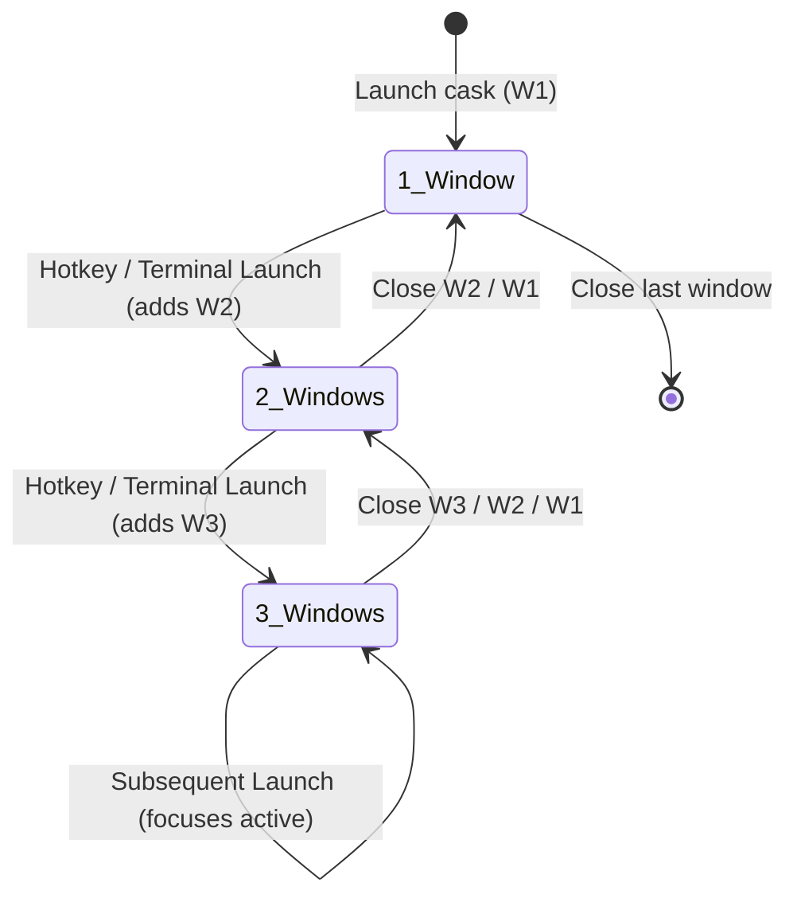
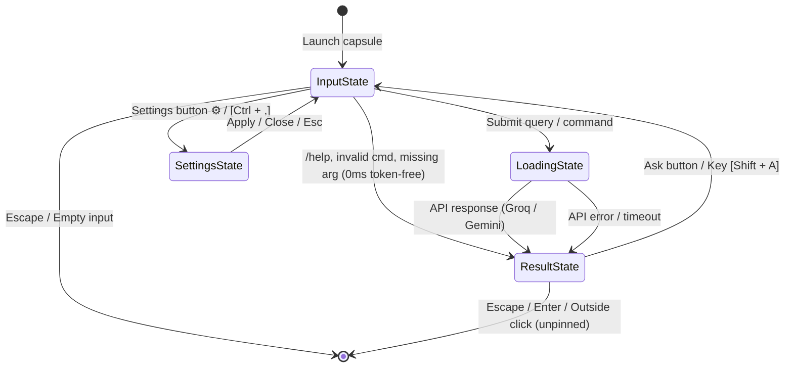

# CAsk (Universal Quick AI Assistant & Command Runner) - Technical Knowledge Base

This document details the software architecture, design principles, technical solutions, and component specifications for CAsk v2.0.

---

## 1. System Architecture & Workflow

- **Project:** CAsk (Universal Quick AI Assistant & Command Runner)
- **Version:** 2.0.0
- **Runtime:** Python 3.10+
- **UI Framework:** Native PyQt6 (Qt6 Widgets)
- **Target OS:** Linux (Fedora, Arch, Ubuntu/Debian)
- **Display Server:** Wayland (Compositor: KDE Plasma 6 / KWin, Hyprland, Sway, GNOME) & X11 fallback
- **AI Backend (Provider Pipeline):**
  - Provider connections own credentials and multiple saved model profiles; exactly one profile is active per provider.
  - Quick selection chooses the primary provider. Remaining enabled providers are tried in saved order, using their active profiles. Result badges identify the actual responder.
  - `core/provider_api.py` supports OpenAI Responses, OpenAI Chat Completions, and Gemini Native. Presets include OpenAI, Groq, Gemini, 9Router, DeepSeek, Ollama, and Custom.
- **Network Layer:** Python standard library `urllib.request` with forced IPv4 resolution (avoiding Wayland/systemd IPv6 DNS lookup latency).
- **Execution Concurrency:** Non-blocking asynchronous Qt worker (`APIWorker` in `QObject` with daemon `threading.Thread`) emitting signals (`finished`, `error`) to preserve 60fps UI responsiveness.
- **Multi-Turn Conversation Engine:**
  - `core/api_client.py`: Request payloads serialize conversational `history` into Groq (OpenAI-compatible) and Gemini (`contents`) schemas.
  - `core/config.py`: Configurable `MAX_FOLLOWUP_TURNS` (default: 3, clamped 1–10).
  - `ui/capsule.py`: Thread state isolation per capsule (`_chat_history`, `_turn_count`).
  - `ui/result_view.py`: Dedicated follow-up input bar (`#FollowUpInput`), turn counter badge (`#TurnBadge`), and shortcut isolation preventing collision between letter typing and action shortcuts.
- **Decoupled System Prompts (`execution/DEFAULT.md` & `execution/commands/*.md`):**
  - All AI personas are externalized markdown files with frontmatter-style metadata.
  - `execution/DEFAULT.md` configures the default behavior when no slash command is used.
  - Modular slash commands (`ask.md`, `eva.md`, `trans.md`) dynamically populate `/help` and autocomplete dropdowns.
- **Configuration & Security:**
  - `providers.json` under the resolved CAsk config directory is authoritative. It is atomically written with permissions `0600`.
  - If absent, migrate `models.json` or legacy settings in memory. Env resolution: process environment > user `config.env` > repo `config.env` > repo `.env`. Original files remain unchanged.
  - Credentials are stored locally in provider records and are never sent to a metadata catalog. Discovery rejects HTTP redirects to avoid forwarding keys to a different endpoint.

---

## 2. Multi-Window Concurrent Architecture (Up to 3 Windows)

CAsk supports up to **3 concurrent independent capsules** arranged in a horizontal grid. The layout dynamically adapts based on the active window count:



### Layout Distribution Rules:

| Active Count | Screen Width Coverage | Slot 0 (Left) | Slot 1 (Center) | Slot 2 (Right) | Description |
| :--- | :--- | :--- | :--- | :--- | :--- |
| **1 Window** | Standard (600 / 760px) | — | $W_1$ (Centered) | — | Single centered card horizontally & vertically. |
| **2 Windows** | **80% of Screen Width** | $W_1$ (50% of 80%) | — | $W_2$ (50% of 80%) | 2 cards side-by-side with equal width, centered. |
| **3 Windows** | **100% Full Screen Width** | $W_3$ (**30%**) | $W_1$ (**40%**) | $W_2$ (**30%**) | 3 cards with ratio **30 : 40 : 30**. $W_1$ stays in center. |

- **Opening Flow:** Opening $W_1$ centers it. Opening $W_2$ shifts $W_1$ to the left and adds $W_2$ to the right (80% screen). Opening $W_3$ adds $W_3$ to the far left, placing $W_1$ in the center and $W_2$ on the right (full screen 30:40:30).
- **Closing Flow:** Closing any capsule smoothly shifts remaining capsules to the corresponding $N=2$ or $N=1$ layout. Closing the last capsule exits the application.

---

## 3. Capsule Interaction Lifecycle & State Machine

Each capsule (`CAskCapsule`) operates its own isolated state machine:



### State Breakdown:

1. **State 0: Input State (`STATE_INPUT`)**
   - **Dynamic Height Auto-Expansion:** Minimum 50px (single line baseline) up to 220px (clamped max height). Automatically resizes to fit multiple lines and wrapped text.
   - **Multiline Editing:** Pressing <kbd>Shift</kbd>+<kbd>Enter</kbd> inserts a newline. Pressing <kbd>Enter</kbd> submits.
   - **Scrollbar Behavior:** Scrollbar is strictly hidden on single lines and empty text (`ScrollBarAlwaysOff`), activating as needed only when reaching 220px.
   - **Autocomplete:** Typing `/` opens a `QCompleter` dropdown displaying registered commands (`/help`, `/ask`, `/check`, `/eva`, `/trans`).
   - **Settings Shortcut & Button:** Integrated gear button `⚙` on the right side and <kbd>Ctrl</kbd> + <kbd>,</kbd> shortcut triggers `STATE_SETTINGS`.
   - **Focus Retention:** Persistent across focus loss; users can click background windows without dismissing the input bar.

2. **State 1: Loading State (`STATE_LOADING`)**
   - **Dimensions:** 54px height.
   - **Styling:** Semi-transparent glass capsule with animated dots and custom loading label.
   - **Focus Retention:** Persistent during background API queries; does not dismiss when user interacts with background windows.

3. **State 2: Result State (`STATE_RESULT`)**
   - **Dimensions:** Elastic height calculated from markdown document geometry (min 190px up to 840px max).
   - **Header Action Bar:**
     - **Drag Handle (`#DragHandle`):** SVG 6-dot grip icon `⋮⋮` allowing drag-and-drop window reordering with live drop preview and tooltip indicating `[Alt + ← / →]`.
     - **Status Badge:** Identifies result type (e.g. `Help`, `/ask`, `/check`, `/eva`, `/trans`, `Assistant`).
     - **Ask (`#AskButton`):** SVG magnifying glass icon + `Ask` (Shortcut: <kbd>Shift</kbd> + <kbd>A</kbd>). Switches back to the input bar to refine or submit a new query.
     - **Copy (`#CopyButton`):** SVG clipboard icon + `Copy` (Shortcut: <kbd>Shift</kbd> + <kbd>C</kbd> / <kbd>Ctrl</kbd> + <kbd>C</kbd>). Copies full markdown to clipboard with temporary `✓ Copied!` confirmation.
     - **Pin (`#PinButton`):** SVG pushpin icon + `Pin` / `Pinned` (Shortcut: <kbd>Shift</kbd> + <kbd>P</kbd>). Toggles window pinning.
     - **Exit (`#ExitButton`):** SVG cross `✕` icon + `Exit` (Shortcut: <kbd>Esc</kbd>). Dismisses the card.
   - **Multi-Turn Follow-Up Footer Bar:**
     - **Follow-up Input (`#FollowUpInput`):** Translucent input bar embedded at the bottom of the card for follow-up questions within the active capsule context.
     - **Turn Counter Badge (`#TurnBadge`):** Real-time indicator displaying `(current_turn / max_turns)`.
     - **Turn Limit Enforcement:** Automatically locks input and displays guidance when reaching `MAX_FOLLOWUP_TURNS` (default 3, clamped 1–10).
     - **Shortcut Guarding:** When focused in the follow-up input bar, typing uppercase letters (<kbd>Shift</kbd> + <kbd>A</kbd>, <kbd>Shift</kbd> + <kbd>P</kbd>, <kbd>Shift</kbd> + <kbd>C</kbd>) is safely preserved without triggering window shortcuts.
   - **Window Reordering Shortcuts:** <kbd>Alt</kbd> + <kbd>←</kbd> and <kbd>Alt</kbd> + <kbd>→</kbd> swap the focused capsule with its adjacent left/right slot while preserving predefined slot geometry ratios (e.g., 30 : 40 : 30). This functions seamlessly in both the **Input Bar** (without conflicting with text selection/highlighting) and the **Result Box**.
   - **Pinning Rules:** When pinned (`is_pinned == True`), the card **cannot** be dismissed by clicking outside, pressing <kbd>Esc</kbd>, or pressing <kbd>Enter</kbd>. It can only be dismissed via the Exit button or by unpinning.

4. **State 3: Settings State (`STATE_SETTINGS`)**
   - **Dimensions:** 760px target height clamped to available space; one Settings capsule uses up to 860px width.
   - **Navigation:** Provider overview, Add Model catalog, Configure Model, and Edit Model are embedded pages. Back/Escape returns through the page flow; Close exits Settings. No model dialog is opened.
   - **Providers:** One expanded accordion, collapsed connection details, inline overflow actions for enabling, reordering, and removing connections.
   - **Models:** Bounded scrolling saved-model rows, one active profile per provider, inline actions and removal confirmation. Add Model remains outside the model scroll area.
   - **Persistence:** Apply atomically writes private `providers.json` and updates all capsules. Cancel discards the Settings draft. Network and stale-draft protections remain active.

---

## 4. Technical Solutions & Wayland Optimizations

### 📌 Solution 1: Unified Window Masking for Multi-Window Precision
- **Challenge:** Under Wayland (`xdg_shell`), client applications cannot programmatically set window coordinates (`move()` / `setGeometry()` are ignored by KWin). Creating 3 separate OS-level windows causes KWin to cascade them unpredictably.
- **Solution:** A single screen-covering frameless transparent `MainWindow` orchestrates child `CAskCapsule` widgets with pixel-perfect coordinates. Using `setMask(QRegion)`, transparent spaces between and around cards are excluded from input regions, allowing clicks to pass through directly to background applications.

### 📌 Solution 2: Resolution-Independent SVG Vector Icons
- **Challenge:** Emoji characters (e.g. 📌, 🔍) frequently fail to render or show as missing glyph boxes on Linux distributions lacking emoji fonts or using monospace fonts (`JetBrains Mono`).
- **Solution:** Integrated `ui/icons.py` using `QSvgRenderer` to render crisp vector icons directly into `QIcon` objects with exact Catppuccin-inspired theme colors (`#e6ebf5`, `#f9e2af`, `#89b4fa`).

### 📌 Solution 3: Keyboard Shortcut Interception via Event Filter & Dynamic Reordering
- **Challenge:** `QTextBrowser` absorbs focus in the result view; default key handlers in parent frames would not fire for unhandled keys. Additionally, using Shift+Arrow inside `QTextEdit` triggered text highlighting instead of swapping windows, and users required the ability to swap window positions dynamically without losing predetermined geometry ratios.
- **Solution:** Installed an event filter on `QTextBrowser` and child controls in `ResultView`, `InputBar`, and `MainWindow` that intercepts:
  - <kbd>Shift</kbd> + <kbd>A</kbd>: Return to input bar.
  - <kbd>Shift</kbd> + <kbd>P</kbd>: Toggle pin status.
  - <kbd>Shift</kbd> + <kbd>C</kbd> / <kbd>Ctrl</kbd> + <kbd>C</kbd>: Copy markdown output.
  - <kbd>Alt</kbd> + <kbd>←</kbd> / <kbd>Alt</kbd> + <kbd>→</kbd>: Move/swap active capsule slot left or right (operates in both InputBar and ResultView without conflicting with text selection).
  - <kbd>Alt</kbd> + <kbd>H</kbd>: Toggle Always-on-Top / window stacking (unhide / hide from top layer across both InputBar and ResultView).
  - Interactive mouse dragging on `#DragHandle` (`⋮⋮`) with `DropGhostIndicator` providing live visual target slot feedback and ratio recomputation.
  - <kbd>Esc</kbd> / <kbd>Enter</kbd>: Dismiss unpinned cards.

### 📌 Solution 4: Elimination of Premature Scrollbar on Line 1
- **Challenge:** `QTextEdit` with `ScrollBarAsNeeded` on small initial heights caused sub-pixel document margins to trigger a vertical scrollbar even on empty or single-line text.
- **Solution:** Configured `setDocumentMargin(2)` and locked `ScrollBarAlwaysOff` while height < 220px. Switched to `ScrollBarAsNeeded` only when reaching maximum clamped height.

### 📌 Solution 5: Single-Instance HUD Enforcement & IPC Launch Routing
- **Implementation:** Implemented `ui/single_instance.py` using kernel file locking (`fcntl.flock`) on `f"{app_name}_{uid}.lock"` and `QLocalServer`. Subsequent invocations transmit `ACTIVATE:<query>` over IPC, invoking `MainWindow.handle_external_launch(query)` to spawn card 2 or 3.

### 📌 Solution 6: Universal Linux Vietnamese IME Compatibility & Instant Composition Expansion
- **Challenge:** Under Wayland, PyQt6 wheels bundled via pip lack `libfcitx5platforminputcontextplugin.so` (present only in system Qt), causing Qt6 to reject `QT_IM_MODULE=fcitx` and fall back to raw Compose (disabling Vietnamese IME such as `fcitx5-bamboo`). Additionally, missing `inputMethodEvent` / `inputMethodQuery` overrides in custom `QTextEdit` subclasses breaks surrounding-text diacritic transformation. Furthermore, during Vietnamese composition (e.g. typing a multisyllabic or accented word before pressing Space), uncommitted characters reside exclusively in IME `preeditString`. Evaluating height based solely on `toPlainText()` caused the input bar to defer line expansion until a space committed the word.
- **Solution:** 
  - Implemented `configure_linux_ime()` in `ui/app.py`: auto-detects running IME daemons (`fcitx5` / `ibus`) and automatically redirects to `ibus` emulation when `fcitx5` plugin is missing in the wheel.
  - Enabled `Qt.WidgetAttribute.WA_InputMethodEnabled` and `Qt.InputMethodHint.ImhNone` on `InputBar`.
  - Implemented explicit `inputMethodEvent` and `inputMethodQuery` delegation on `InputBar` to guarantee smooth accent composing.
  - Integrated real-time preedit string tracking in `InputBar`: cloned document geometry injects active `_preedit_text` at cursor position, causing the input bar to immediately expand the moment the composed word wraps to a new line without requiring a trailing space.

### 📌 Solution 7: Dynamic Compositor Stacking & Flicker-Free Layer Switching (<kbd>Alt</kbd> + <kbd>H</kbd>)
- **Challenge:** On Wayland (KWin / KDE Plasma 6), calling `setWindowFlags()` on a live window recreates the native `wl_surface`, triggering compositor fade animations, destroying `setMask()` bounds, and failing to lower the window due to `xdg_shell` client-lowering restrictions. Furthermore, hardcoded `kwinrulesrc` rules with `aboverule=3` ("Force Keep Above") previously overrode any application-level stacking change. Additionally, under Wayland `xdg_toplevel`, `Qt.WindowType.WindowStaysOnTopHint` is ignored by KWin upon initial window mapping (`initial_keepAbove=false`), and Wayland surface registration in KWin's `workspace.windowList()` occurs asynchronously (~30-50ms after `show()`), causing CAsk to lose always-on-top on launch until explicitly toggled via Alt+H.
- **Solution:** 
  - Purged hardcoded forced `aboverule=3` rules from `install.sh` and user configuration.
  - Implemented dynamic KWin scripting layer switching in `MainWindow`: commands KWin's compositor directly via DBus (`org.kde.KWin /Scripting`) to toggle `keepAbove` and `keepBelow` (`w.keepAbove = false; w.keepBelow = true;`).
  - Proactive Launch-Time Enforcement (`_apply_initial_layer`): Triggered via `showEvent` and `handle_external_launch` with stepped retry backoff (40ms, 80ms, 160ms, 300ms, 500ms) to guarantee that as soon as KWin maps the asynchronous Wayland surface, `w.keepAbove = true` is immediately enforced without requiring manual toggle.
  - Achieves instant, flicker-free window ranking behind all standard application windows without surface destruction or window mask disruption. Cross-platform fallback via `WindowStaysOnBottomHint` handles non-KDE environments.

### 📌 Solution 8: Multi-Turn Conversation History Isolation, Thread Safety & Command Routing
- **Challenge:** Lightweight HUD cards risk layout overflow or sluggishness if conversational threads grow without bound. Furthermore, transitioning to a full loading state between follow-up questions collapses and expands window geometry (54px to 800px), causing severe visual jitter. Additionally, calling methods like `isRunning()` on C++ `QThread` wrappers deleted prematurely by Qt's event loop caused fatal SIGABRT crashes (`RuntimeError: wrapped C/C++ object of type APIWorker has been deleted`). Furthermore, pressing <kbd>Enter</kbd> to submit a follow-up query inadvertently bubbled up to `MainWindow.keyPressEvent`, dismissing unpinned cards. Lastly, users required slash command routing and autocomplete within the response box follow-up bar with distinct visual highlighting for their follow-up questions.
- **Solution:** 
  - **Isolated Thread State:** Maintained per-capsule `_chat_history` in `CAskCapsule`. Opening card 2 or 3 retains separate independent contexts.
  - **In-Place Progress State:** During follow-up query execution, the card remains in `STATE_RESULT`, disabling `#FollowUpInput` and setting `#TurnBadge` to `(thinking)`. Previous conversation text remains fully visible and legible, eliminating height collapsing.
  - **Thread Safety & Crash Elimination (QObject Daemon Worker):** Refactored `APIWorker` from a `QThread` subclass to a `QObject` with Qt signals running on a Python daemon `threading.Thread(daemon=True)`. Eliminated Qt C++ fatal crashes (`qFatal("QThread: Destroyed while thread is still running")` / `_ZN10sipQThreadD0Ev` / `SIGABRT`) when workers are overwritten or deallocated during prompt submissions or follow-ups. Added `is_worker_active()` with `sip.isdeleted()` checks and `RuntimeError` guards. Controlled joining (`stop_worker()`) terminates running workers safely on capsule close or query reset.
  - **Enter Key Decoupling & Input Focus:** Completely eradicated <kbd>Enter</kbd> / <kbd>Return</kbd> from closing or dismissing CAsk. Instead, pressing <kbd>Enter</kbd> while viewing responses or when focus is outside editable input fields instantly focuses the input bar (`#FollowUpInput` in `ResultView`, `#InputBar` in input state).
  - **Full Slash Command Support in Follow-Up Bar:** Integrated `CommandCatalog` and `QCompleter` into `ResultView`'s `#FollowUpInput`. Routed follow-up inputs through `route_input`: dynamically adopting command system prompts (e.g. `/trans`, `/eva`), providing instant token-free `/help`, and highlighting active command tokens (`is_command="true"`).
  - **Yellow Follow-up Turn Highlighting:** Formatted user follow-up questions with Catppuccin Yellow `.user-turn` (`#f9e2af`) with left accent border and translucent backdrop, while preserving standard clean markdown formatting when copying to the system clipboard.
  - **Cross-Backend Serialization:** `core/api_client.py` serializes `history` seamlessly into Groq's OpenAI-compatible message list (`[{"role": "user"|"assistant", "content": ...}]`) and Gemini's hierarchical `contents` (`[{"role": "user"|"model", "parts": [...]}]`).
  - **Configurable Clamping:** Bounded by `MAX_FOLLOWUP_TURNS` (default 3, clamped 1–10). Preserves the single-card transient HUD philosophy while enabling multi-turn follow-up workflows.

### 📌 Solution 9: Unified Code Block Rendering & Corner Transparency Artifact Removal
- **Challenge:** 
  1. In `QTextBrowser`, block elements like `<pre>` with `background-color` or `border` are parsed into separate `QTextBlock`s per newline. Because Qt's rich text engine does not support descendant CSS selectors (such as `pre code`), `<code>` styles bled into `<pre>`, rendering code blocks as disconnected, striped individual lines with jarring gaps between lines instead of a single solid block.
  2. All three window capsules (Input bar, Loading bar, Response box) exhibited square gray corners protruding behind the rounded glassmorphic edges.
- **Solution:**
  - **Solid Code Block Container (`core/markdown_renderer.py`):** Transformed fenced and block code into single-cell `<table class="code-block" ... bgcolor="#11111b">` wrappers containing `<pre>`. Qt renders the table cell as a single cohesive solid background with rounded borders and padding. Converted inline code to `<span class="inline-code">`, keeping inline code backgrounds distinct from block code.
  - **Corner Artifact Elimination (`ui/capsule.py` & `ui/main_window.py`):** Identified `QGraphicsDropShadowEffect(self.container)` as the root cause of the square gray corner protrusion, where Qt computed an offscreen blur convolution against the rectangular bounding frame of `QFrame`. Removed the shadow effect and enforced `WA_TranslucentBackground` on `CAskCapsule` and `CentralContainer`. Tightened `card_rect` mask bounds in `MainWindow._recompute_layout` to produce crisp, anti-aliased rounded corners without rectangular bleeding.

### 📌 Solution 10: Objective Verification & Counter-Argument Command (`/check`)
- **Requirement:** Introduce a dedicated `/check <statement>` command to critically challenge premises, verify factual accuracy, and expose logical fallacies, unstated assumptions, and edge cases.
- **Implementation:**
  - **Template Specification (`execution/commands/check.md`):** Configured modular prompt with dual-language structure (Vietnamese and English) matching the user input language. Instructs the LLM to deliver zero conversational fluff, an objective preliminary verdict, categorized logical flaws/fallacies, empirical counter-examples, and a calibrated refined proposition.
  - **Dynamic Routing & Loading:** Registered seamlessly into `CommandCatalog`, `core/router.py`, and `QCompleter` autocompletion without code modifications to core routing logic.
  - **Symlink Management (`install.sh`):** Added dangling symlink pruning (`find ... -xtype l -delete`) before copying or symlinking execution templates to guarantee idempotent installation across renames or directory changes.

### 📌 Solution 11: In-HUD Model Settings Panel & Provider Pipeline (`STATE_SETTINGS`)
- **Requirement:** Allow users to interactively configure, test, enable/disable, reorder, create, and delete response models via GUI without manually editing `config.env`.
- **Implementation:**
  - **In-Capsule State Transition (`STATE_SETTINGS`):** Flipped active capsule to settings mode upon clicking the input bar gear icon `⚙` or pressing <kbd>Ctrl</kbd> + <kbd>,</kbd>. Preserves single-window geometry and Wayland `setMask` bounds without secondary popup dialog issues.
  - **Dynamic Model Cards (`ui/settings_view.py`):** Each `ModelCardWidget` exposes display name, protocol (`openai_compatible` / `gemini`), base URL, model ID, API key, and enabled toggle. Existing `temperature` and `max_tokens` metadata is preserved on save without GUI editors; request temperature remains fixed at `0.2`. Cards support:
    - **Add:** `Add Model Card` button with a single plus icon creates new cards from preset templates (Groq, 9Router, Gemini, DeepSeek, Ollama, Custom Endpoint).
    - **Delete:** Trash button removes cards (disabled when only 1 card remains).
    - **Reorder:** Up/Down arrow buttons (`▲` `▼`) configure primary and fallback ranking with live priority badge refresh (`[Primary]`, `[Fallback N]`, `[Inactive]`).
    - **Edit:** Inline name editing, protocol selector, editable model combo with preset suggestions, and password reveal toggle (`👁`).
  - **Asynchronous Live Ping Test (`⚡ Test`):** Runs minimal ping prompt in daemon thread to measure roundtrip latency in real-time (`✓ 0.62s`) without blocking the Qt event loop.
  - **Structured Persistence (`core/model_config.py`):**
    - **`models.json`:** Primary configuration file at `~/.config/cask/models.json` storing the full model pipeline as a JSON array of `ModelEntry` objects.
    - **Migration Fallback:** When `models.json` does not exist, entries are auto-synthesized from legacy `config.env` variables (`GROQ_API_KEY`, `GEMINI_API_KEY`, `CUSTOM_OPENAI_*`, `PROVIDER_ORDER`).
    - **Backward Compatibility Sync:** On save, primary keys (`GROQ_MODEL`, `GEMINI_MODEL`, `PROVIDER_ORDER`, etc.) are written back to `config.env` for legacy compatibility.
  - **Hot-Reloading (`core/config.py`):** `save_config_file()` atomically writes key updates to `~/.config/cask/config.env` while preserving comments, immediately hot-reloading runtime `Config` across all active capsules.
  - **Built-in Presets (`core/model_config.py` → `PRESETS`):** Catalog of provider templates (Groq Cloud, 9Router, Google Gemini, DeepSeek API, Ollama Local, Custom) with default URLs, model IDs, and suggested model lists.

### Solution 12: Model Settings Interaction Fixes (2026-11-13)
- **Scope:** Prevent accidental dropdown changes, simplify action labels, and resolve connection tests remaining at `Testing...`.
- **Implementation (`ui/settings_view.py`):**
  - `WheelSafeComboBox` handles protocol, model ID, and preset dropdowns. Wheel events over closed controls, including the editable model field, are forwarded to the nearest `QScrollArea`; selection requires explicit keyboard or popup interaction.
  - The apply button reads `Apply`. `Add Model Card` retains its plus icon and omits the redundant plus in its text.
  - Connection tests retain the background daemon thread and the existing eight-second network timeout. `connection_test_finished` uses a queued Qt signal to deliver results to `_apply_test_result` on the GUI thread, replacing the worker-thread `QTimer.singleShot` callback that could remain undelivered.
  - Provider failures and unexpected exceptions update the result label and re-enable testing. Tooltips expose full error text. Results emitted after card deletion are safely discarded.
  - Removed the duplicate `ModelCardWidget` constructor and signal declarations.
- **Verification:** All 58 core/UI tests passed headlessly with a temporary `XDG_RUNTIME_DIR`. `tests/test_settings_view.py` covers focused/unfocused wheel input, editable fields, panel scrolling, popup/keyboard selection, queued results, success/failure/timeout/retry, and deletion during a request. The existing reorder test now supplies its own three-model fixture instead of depending on personal configuration. Connection responses were mocked; live provider credentials were not exercised.
- **UI Review:** The original stylesheet kept `#SettingsView` transparent while cards had their own backgrounds, leaving outer text dependent on the desktop behind it. The user approved a continuous dark panel (`#1b1f26`), lighter cards (`#262d38`), darker inputs, and brighter secondary labels. Solution 13 applies this theme.
- **Resource Organization (2026-11-13):** Bug screenshots were moved from `bug_screenshots/` to `resources/bug_screenshots/` and remain ignored by Git. The proposed UI preview is tracked at `resources/references/model-settings-proposed.png` and linked from `README.md`, replacing reliance on a temporary preview path.

### Solution 13: Approved Settings Theme and Transparent Rounded Corners (2026-11-13)
- **Theme (`ui/styles.qss`):** `#SettingsView` paints an opaque `#1b1f26` surface with a `#454b56` border and 14px radius. Cards use `#262d38` with 10px corners. Subtitle and field labels use `#bbc4d6`. Existing input styling, layout, and settings height remain unchanged.
- **Painting (`ui/settings_view.py`):** `SettingsView` explicitly enables `WA_StyledBackground` and disables automatic palette filling. Its rounded QSS surface is painted inside the existing translucent `MainWindow`, `CAskCapsule`, and `CentralContainer` hosts. Do not add a rectangular background to those hosts or set `WA_TranslucentBackground` on the styled child panel; the latter suppresses its background painting in the tested Qt setup.
- **Reference Capture:** A normal top-level Qt frame fills its rectangular window background behind rounded QSS borders. The original reference had alpha 255 at all four outer corners. The updated `resources/references/model-settings-proposed.png` is rendered with the application stylesheet inside a frameless translucent host and has alpha 0 at all four corners, while the panel interior remains opaque. It uses an 800x620 preview size and placeholder endpoints without credentials.
- **Verification:** All 59 tests passed headlessly with a temporary `XDG_RUNTIME_DIR`. The rendering regression test samples all four outer corners and header/footer background pixels in `MainWindow` across two Settings/Input cycles. It also passed with `QT_SCALE_FACTOR=2`. Native compositor appearance was not exercised by these offscreen tests.

---

### Solution 14: Provider-First UI Mockups (2026-11-13)
- **Accepted Design Direction:** Provider cards own connection details and multiple saved model configurations. Exactly one model configuration is active per provider, with quick switching between saved configurations. The user requested mockups before implementation.
- **Artifacts (`resources/references/`):** `provider-settings-mockup.png` shows an expanded OpenAI provider with Sol Medium/Sol High configurations and a collapsed Groq provider. `provider-model-picker-mockup.png` shows catalog search and configuration fields. The latest user-approved direction for `provider-quick-switch-mockup.png` is a single rounded input capsule: query area above, existing gear button at the top right, and provider/model buttons on a lower row inside the same capsule. There is no send button or detached control row. The renderer checks transparent outer corners and an opaque background beside the lower controls. This supersedes the previous arrow-send and detached-control mockups. `README.md` links and explains all references.
- **Reproducibility:** Run `QT_QPA_PLATFORM=offscreen python3 resources/references/generate-provider-mockups.py`. The renderer uses only placeholder data, does not load credentials, and checks transparent outer corner pixels. All three views were rendered and visually inspected.
- **Implementation Boundary:** These are presentation-only references; the application's model-entry schema, settings controls, routing, and discovery behavior have not changed. Provider fallback order is illustrated as a proposal. Catalog integrations, parameter compatibility, persistence, and final HUD scrolling still require implementation and review.

### Solution 15: Gemini-Inspired Input Mockups (2026-11-13)
- **Reference Inputs:** The user supplied `resources/references/gemini_1.png`, `gemini_2.png`, and `gemini_3.png` and requested visual styling for provider/model/settings controls only.
- **Latest Input Layout:** `provider-quick-switch-mockup.png` supersedes the earlier quick-switch layouts: a 32px-radius dark capsule contains query input above and a lower toolbar with provider left, model and gear right. The gear now follows the reference toolbar placement. No send, microphone, attachment, or other Gemini features are included.
- **Menu States:** `provider-quick-switch-provider-menu.png` and `provider-quick-switch-model-menu.png` illustrate pill-shaped expanded selectors and 24px-radius menus with secondary labels and selection checkmarks. Menus contain placeholder CAsk connections and saved configurations, not live catalog data.
- **Verification:** The renderer produces five mockups; all outer corner alpha checks pass. The default input and both menu states were visually inspected. These changes remain confined to mockup assets and documentation; runtime UI is unchanged.
- **Color/Opacity Correction:** The user accepted the layout but requested the existing CAsk colors and transparency. Quick-switch mockups now use the current `#InputBar` background `rgba(27, 31, 38, 0.75)`, the completer popup background `rgba(27, 31, 38, 0.95)` for menus, translucent white borders, existing foreground colors, and yellow interaction accents. Gemini-inspired geometry is retained. The renderer asserts input alpha approximately 191/255, menu alpha approximately 242/255, and zero alpha outside rounded corners. Runtime styling remains unchanged.

### Solution 16: Provider-First Runtime Implementation (2026-11-13)
- **Status:** The provider-first flow and embedded quick selectors are now implemented in the application. Solutions 14/15 describe design history; their presentation-only boundary no longer applies to the runtime feature.
- **Data (`core/provider_config.py`):** Version 1 `providers.json` stores `selected_provider_id` and ordered provider records. A provider has `id`, `name`, `kind`, `protocol`, `base_url`, `api_key`, `enabled`, `models`, `active_model_id`, `catalog`, and `catalog_updated_at`. A `ModelProfile` has `id`, `name`, `model`, optional `reasoning`, `temperature`, `max_tokens`, and a Chat Completions `token_parameter`. Missing optional values mean provider defaults, not guessed sampling settings.
- **Migration/Persistence:** Group legacy entries by protocol, endpoint, and credentials; keep variants and select the first enabled variant. Preserve explicit model-file order or legacy provider priority. Migration is in memory until Apply/quick selection, which writes a private atomic provider file. Empty/disabled provider lists never fall through to old keys. Corrupt authoritative files fail explicitly; `cask.py` reports a configuration error without a traceback. There is no save-back to legacy env/model files.
- **Discovery (`core/provider_api.py`):** Fetch `/models` relative to the configured API root, or Gemini `/v1beta/models`, including pagination and cursor-loop detection. Deduplicate model IDs and enrich from provider methods plus a bundled verified GPT-6.1 Sol capability entry. Unknown models remain selectable with unverified capabilities; known non-text Gemini models are disabled in the picker. No models.dev download or subscription/OAuth connector is implemented. API root paths are preserved, including custom version prefixes.
- **Requests:** Responses uses instructions/input, reasoning effort, optional `max_output_tokens`, and `store: false`. Chat Completions uses messages, optional reasoning effort, and the configured token parameter; GPT-6.1 Sol uses `max_completion_tokens`. Reasoning requests omit temperature. Gemini uses native system instruction/contents/generation config. Responses incomplete/failed states are errors, not successful answers. Provider requests use a 60-second socket timeout, discovery 15 seconds, and model tests 30 seconds. Redirects are rejected and errors redact the provider key.
- **Settings (`ui/provider_settings.py`):** Provider cards edit shared credentials/protocol/root, connect/refresh, collapse, enable/remove/reorder, and manage saved profiles with radio selection, Add/Settings/Duplicate/Remove/Test. The searchable model dialog accepts manual IDs and optional parameters. Apply saves a deep-copied draft; Cancel discards it. Applying waits for background work and rejects stale drafts after another capsule updates configuration. Removing an active profile while alternatives exist requires explicitly selecting another profile first.
- **Cache/Concurrency:** Only Apply persists successful discovery results/timestamps. Failed refresh keeps the old catalog; successful refresh never deletes saved profiles or changes selection. Credential/root/protocol edits invalidate the draft cache and increment a generation counter so stale network results are discarded. Daemon threads signal the Qt thread; deleted cards safely ignore late results.
- **Input/Results:** `InputBar` remains a `QTextEdit` for IME, completion, and Enter/Shift+Enter behavior. A reserved lower viewport margin prevents typing from overlapping provider/model/gear buttons. Quick menus change primary/profile immediately, persist the selection, retain typed text, and synchronize capsules. No send button is added. Input background remains 75%/85% on focus; selector menus use 95% opacity. Result badges wrap and show source names/IDs, including fallback sources.
- **Geometry/Theme:** Settings has a translucent 75% outer panel, scrollable cards, and a 620px target height clamped to available space. A single Settings capsule expands to at most 860px within screen margins. Dialogs use translucent hosts and rounded child surfaces. Former model-card widgets remain in `ui/legacy_settings_view.py` for the old reference renderer and regression coverage; `ui/settings_view.py` exports the current provider editor plus compatibility aliases.
- **Verification:** The suite covers migration, private persistence, authoritative empty config, malformed files, pagination, unknown/non-text models, compatible Sol requests, fallback/source attribution, stale discovery, model dialogs, Apply/reload, quick selection, stale drafts, viewport bounds, Enter handling, and an end-to-end connect/add/apply/query flow. Real HTTP discovery/generation was exercised against a local fake provider; no paid API or personal key was used. Runtime input/settings/dialog renders were visually inspected offscreen. Native compositor behavior and live provider entitlement remain unverified.
- **Final Checks:** All 79 tests passed with a temporary `XDG_RUNTIME_DIR`; the provider test subset also passed at `QT_SCALE_FACTOR=2`. `git diff --check` and the CLI version command passed. No personal provider file was written during verification.

### Archived Handoff: Approved Settings Revision and Blur (2026-11-14)

This pre-implementation handoff is superseded by the completed handoff below.
- **Approved:** The user accepted the six `settings-v2-*.png` references and now wants implementation planning plus real backdrop blur. The runtime still uses the earlier provider editor; revision 2 remains reference-only.
- **Settings Scope:** Apply the revision 2 typography hierarchy, one-open-provider accordion, compact saved-model rows in bounded scrolling containers, collapsed connection details, inline model/provider removal confirmation, and stacked Add/Edit pages with Back. Preserve drafts, provider expansion, and scroll position. Only Settings must avoid overlapping windows; retain the existing multi-capsule application behavior.
- **Visual Requirement:** Preserve CAsk colors and opacity while adding compositor-driven blur behind the translucent window surfaces. Keep text and controls sharp. PNG alpha transparency is not proof of live backdrop blur.
- **Observed Environment:** `XDG_CURRENT_DESKTOP=KDE` and `XDG_SESSION_TYPE=wayland` were checked. `ui/main_window.py` currently sets `kwin_blur=True`, but no native blur-behind call was found in the project.
- **Candidate Backend:** Investigate a PyQt6-compatible bridge to `KWindowEffects::enableBlurBehind(QWindow*, bool, QRegion)` or the supported Wayland background-effect protocol. Official reference: https://api.kde.org/kwindoweffects.html . Binding availability, compositor effect state, and actual on-screen behavior are not yet verified. Do not use `QGraphicsBlurEffect` on the UI to simulate backdrop blur; it blurs its source content.
- **Region/Lifecycle:** `MainWindow` spans the screen and masks capsule areas. Never request blur for the entire surface by passing an empty region. Derive blur regions from the visible rounded capsule shapes; update when geometry, state, capsule count, or display scaling changes. Transparent corners and gaps must remain unaffected. If unsupported/disabled, keep the existing translucent rendering as a fallback.
- **Suggested Work Order:** Implement the approved Settings navigation/layout first, then isolate native blur integration and verify it on the real KDE/Wayland desktop. Existing offscreen tests can cover geometry/alpha but cannot prove the compositor blurs other applications.

### Solution 17: Settings Revision 2 Runtime (2026-11-14)
- **Implementation:** `ui/provider_settings.py` uses `SettingsView.pages` for the persistent overview and an embedded `ModelEditor(QWidget)`. The editor contains catalog/configuration pages; Edit starts at configuration. Back from Configure preserves model name, optional parameters, search, and catalog selection. Returning to overview retains provider drafts, expansion, and scroll position because those widgets are kept alive.
- **Hierarchy/Geometry:** Current font family, 14pt title, 11pt provider names, 10pt controls, 9pt secondary labels. Settings retains its 75% `#1b1f26` outer surface, translucent cards, yellow interaction accents, and transparent 14px corners. Target height is 760px, clamped by available screen height. The existing single-capsule width limit is 860px. Multi-capsule slot ratios and routing remain in effect.
- **Accordion/Connections:** Initially expand the first provider. Opening another collapses the previous provider; clicking an open header closes it. Connection fields start collapsed. Provider overflow reveals enabled/reorder/remove actions inline. New providers open their connection fields. Existing presets, credential masking, discovery cache invalidation, daemon workers, and stale network result handling are retained.
- **Saved Models:** Compact rows use a 214px scrolling viewport; removal confirmation expands it to 258px. Add Model is outside that viewport. Row overflow reveals Test, Settings, Duplicate, and Remove inline. Remove opens a confirmation without changing the draft until explicitly confirmed. The active profile cannot be removed while alternatives exist until another profile is selected. Provider removal also requires an inline confirmation.
- **Persistence:** Editor Save changes only the provider draft. Apply remains the persistence boundary; network-in-progress and stale-config checks remain intact. Catalog/manual IDs, non-text model restrictions, provider-default optional parameters, and reasoning/temperature compatibility are retained. Close exits Settings; editor Cancel returns to overview; Escape follows Back before closing Settings.
- **Evidence:** All six runtime states were rendered and visually inspected using placeholder data. Added `tests/test_settings_v2.py` for embedded navigation, draft isolation, accordion/scroll behavior, removal cancellation/active-profile guards, and alpha checks. Existing provider workflow tests now drive the embedded editor instead of a modal dialog.

### Solution 18: Native Wayland Backdrop Blur (2026-11-14)
- **Transport (`ui/wayland_blur.py`):** Prefer the compositor-advertised `ext_background_effect_manager_v1` and its blur capability. Support `org_kde_kwin_blur_manager` v1 as a legacy fallback. These requests affect background content; no `QGraphicsBlurEffect` is used. The previous inert `kwin_blur` dynamic property was removed.
- **Qt Integration:** Use `ctypes` and `PyQt6.sip` to resolve the display/surface native-resource functions from the running PyQt Qt library directory. Only the native-resource lookup uses Qt private ABI. Symbol/library/platform/protocol absence leaves ordinary translucency. Do not load system KF/Qt into the wheel: the installed `libKF6WindowSystem.so.6` probe failed with missing `Qt_6.11_PRIVATE_API` even though both installations report Qt 6.11.2.
- **Ownership:** Qt owns display reads, dispatch, and the surface. The bridge owns a separate registry event queue, manager/compositor proxies, and effect objects. It dispatches pending events only on that queue via a Qt timer, without reading or disconnecting Qt's display. Native calls and callbacks run on the GUI thread. Standard effect state is applied through Qt's next surface commit.
- **Regions (`ui/backdrop.py`, `ui/main_window.py`):** Conservative rounded scanlines in surface-local logical pixels are shared by the input mask and blur requests. Input radius is 28px; Loading/Result/Settings radius is 14px. Coordinates are not multiplied by device pixel ratio. Gaps and rounded corners are excluded. Empty visible regions destroy/unset the effect instead of requesting whole-surface blur. Geometry/state/count changes, show/hide, exposure, surface recreation, screen changes, DPI changes, and device-pixel-ratio changes refresh or detach regions.
- **Fallback/Limits:** The live environment advertised the standard protocol and blur capability with KWin's blur effect loaded. That path was verified on the desktop. Legacy KDE protocol handling and disabled/missing-backend behavior have regression coverage; the legacy path was not exercised against an older compositor. The private native-resource lookup is an explicit compatibility boundary; keep its failure path nonfatal.
- **Reproducible Desktop Check:** `QT_QPA_PLATFORM=wayland python3 resources/verify-desktop-blur.py`. Requires Spectacle. Generates a controlled striped background and placeholder providers in a temporary config directory, captures Settings blur on/off, three capsules, and a restored capsule after close/hide/show, then closes its windows. No personal configuration or paid API is used. Output defaults to ignored `resources/bug_screenshots/blur-verification/` with PNGs and geometry JSON.
- **Observed Result:** Settings background stripes visibly soften while foreground text stays sharp. Three-capsule gaps and rounded corners remain sharp, and the restored single capsule still blurs. In the initial paired capture, image differences were bounded to `(530, 255, 1390, 1015)`, the Settings surface. An empty interior sample's RGB standard deviation fell from approximately `21.28/20.75/20.10` with blur off to `0.95/0.87/0.82` with blur on. Sampled outside pixels and a transparent 4x4 corner were identical. Captures remain local and ignored by Git.
- **Protocol References:** [Standard background effects](https://wayland.app/protocols/ext-background-effect-v1), [KDE blur protocol](https://invent.kde.org/libraries/plasma-wayland-protocols/-/blob/master/src/protocols/blur.xml), [Wayland client queue API](https://wayland.freedesktop.org/docs/html/apb.html).

### Previous Session Handoff: Settings Revision 2 and Blur Completed (2026-11-14)
- **Completed:** Approved six-reference Settings revision 2, retained CAsk theme/opacity, retained multi-capsule behavior, and integrated native region-limited Wayland blur with actual desktop verification.
- **Validation:** All 90 tests passed normally and at `QT_SCALE_FACTOR=2`. The provider subset passed after the final active-count refresh. `python3 -m compileall -q core ui tests`, `git diff --check`, and `python3 cask.py --version` passed. The tracked desktop verifier completed all four captures successfully. Local logs and early exploratory renders are under ignored `scratch/`.
- **Files:** Main runtime changes are `ui/provider_settings.py`, `ui/styles.qss`, `ui/capsule.py`, `ui/main_window.py`, `ui/backdrop.py`, and `ui/wayland_blur.py`. New regression suites are `tests/test_settings_v2.py` and `tests/test_backdrop.py`. Desktop verification is reproducible using `resources/verify-desktop-blur.py`.
- **Configuration:** No provider schema or migration change; no new user configuration switch. Blur activates when the native protocol/capability is available. Existing credentials, primary/fallback selection, and Apply semantics remain unchanged.
- **Repository:** Changes are split into Conventional Commits for the Settings layout, Settings refinements, native blur integration, and documentation. Push the completed session to the configured `origin/main`. Existing untracked `resources/references/gemini_1.png`, `gemini_2.png`, and `gemini_3.png` are user reference inputs and must remain untouched.
- **Next Session:** Start from this handoff. The previous reference-only Settings handoff is archived; do not reimplement it. No required implementation remains. Optional future coverage: live older-KDE protocol and multi-monitor hotplug/fractional scaling on additional desktops.

### Solution 19: Settings Typography Matches Production Font (2026-11-14)
- **Cause:** Runtime initializes a 12pt application font, while the original visual verifier used Qt's default. A font size on `#SettingsView` alone did not consistently style descendants. Inputs, selectors, and Add Model rendered at 12pt; legacy Apply styling used 9.5pt, producing inconsistent hierarchy and control heights.
- **Correction (`ui/styles.qss`):** Scope a 10pt base to `#SettingsView` and its descendant widgets. Explicitly override the legacy Save button size to 10pt. Retain 14pt titles, 11pt provider names, and 9pt secondary descriptions/badges. Colors, alpha values, and the input/result typography are unchanged.
- **Production Font (`ui/app.py`):** Extract `application_font()` with the existing Nerd Font / JetBrains Mono / monospace selection and 12pt default. Runtime and `resources/verify-desktop-blur.py` now share that initialization. Future visual checks must use the production font, not just the production stylesheet.
- **Regression (`tests/test_settings_v2.py`):** Assert the effective rendered font sizes of title/provider/description roles and overview/editor controls under the production 12pt application default. Verify that an unrelated widget keeps the 12pt base. Compare resolved font pixel sizes so Qt's point-to-pixel rounding does not create false failures.
- **Validation:** All 91 tests passed normally and at `QT_SCALE_FACTOR=2`. All six runtime Settings states were rendered with the production font and visually inspected. The desktop verifier completed Settings on/off, three-capsule, and restored-capsule captures successfully with the corrected font. Updated captures remain under ignored `resources/bug_screenshots/blur-verification/`.

### Latest Session Handoff: Typography Fixed; Per-App Blur Reduction Pending (2026-11-14)
- **User Request:** Fix typography first, then reduce blur strength only for CAsk and report the actual numeric parameter changed so the user can tune it further. Preserve existing colors and opacity.
- **Completed:** Typography correction and shared production-font verification, committed as `5e1dc96`. No changes to the six approved PNG references or the user's untracked Gemini images.
- **Blur Investigation:** Live desktop is KWin 6.8.2 with the stock `blur` effect. Source for that version stores iteration count and sample offset on the shared effect, not per window. `ext-background-effect-v1` accepts a surface-local blur region and has no radius/strength parameter. Legacy KDE blur has the same limitation. Existing CAsk code has no numeric strength value to decrease.
- **Exact Blur Change This Session:** None. Blur strength, blur region behavior, and CAsk opacity remain unchanged. Do not claim a percentage or radius reduction. Do not substitute opacity, checkerboard regions, static screenshots, or temporal toggling for actual blur-strength control.
- **Pending Decision:** Asked whether to expand scope to a dedicated compositor-side KWin effect/integration for CAsk. This requires development dependencies and version-specific integration beyond the app's existing Wayland request. `kwin-devel` and `qt6-qtbase-devel` are not installed. No compositor plugin was installed, no KWin configuration was modified, and no compatibility claim was established for third-party effects on KWin 6.8.2.
- **Primary Evidence:** [Installed-version KWin blur implementation](https://github.com/KDE/kwin/blob/v6.8.2/src/plugins/blur/blur.cpp), [standard protocol definition](https://gitlab.freedesktop.org/wayland/wayland-protocols/-/blob/main/staging/ext-background-effect/ext-background-effect-v1.xml). Stock blur strength uses shared `m_iterationCount` / `m_offset`; setting it through the stock configuration would affect other apps and violate the user's scope.
- **Next Action:** Resume the remaining blur requirement from the user's scope decision. Typography is complete; per-app blur reduction is not complete and has no before/after numeric value yet.

## 5. Project Directory Layout

### Settings Revision 2 Design References (2026-11-14)
- The user requested visual proposals before changing the runtime UI. The single-window scope applies to Settings navigation only; CAsk's multi-capsule feature is retained.
- `resources/references/generate-settings-v2-mockups.py` renders six `settings-v2-*.png` files: overview, Add Model catalog, Configure Model, Edit Model, inline model removal, and inline provider removal. All states use one 800x760 translucent window and stacked content pages; no overlay dialog is created.
- Proposed hierarchy: current CAsk font family, 14pt title, 11pt provider name, 10pt content/controls, 9pt secondary text. One provider is expanded at a time, connection fields are collapsed, and saved model rows sit in a bounded scroll area with Add Model outside that area. Confirmation is inline, with Cancel and an explicit removal action.
- All six states were rendered and inspected. Renderer checks cover one visible top-level window, actual model-list scrolling, 75% panel opacity, and zero-alpha outer corners. `--preview` offers illustrative navigation/accordion interactions with fixed placeholder data; it is not a complete functional Settings replacement.
- The original design task changed references only; Solution 17 now implements that approved direction in runtime. `resources/references/README.md` indexes the proposal separately from historical references.

The latest reference-only transparency update makes `provider-settings-mockup.png`,
`provider-model-picker-mockup.png`, and `model-settings-proposed.png` use 75% opaque
outer backgrounds with translucent nested cards/rows and zero-alpha rounded corners.
`generate-provider-mockups.py` now regenerates all six references, including the original
settings layout with preview-only stylesheet overrides. Header background alpha checks
passed for all three updated panels, and each image was visually inspected. Runtime QSS,
provider behavior, and personal configuration remain unchanged.

```
cask/
├── assets/                    # Project visual assets & branding
│   └── logo.png               # Official CAsk application logo
├── resources/                 # Bug screenshots and design references
│   ├── bug_screenshots/       # Local bug screenshots (ignored by Git)
│   └── references/            # Tracked UI design references
│       └── model-settings-proposed.png
├── cask.py                    # Main executable entrypoint (CLI & PyQt6 HUD)
├── core/                      # Application core logic & network engine
│   ├── __init__.py            # Core package exports
│   ├── config.py              # Environment configuration loader & atomic env writer
│   ├── model_config.py        # Dynamic ModelEntry dataclass, presets, JSON persistence & migration
│   ├── provider_config.py     # Provider/profile schema, legacy migration, private atomic persistence
│   ├── provider_api.py        # Live catalog discovery and protocol-specific request serialization
│   ├── command_loader.py      # Modular slash command scanner & parser
│   ├── router.py              # Deterministic regex router & argument validator
│   ├── math_formatter.py      # LaTeX mathematical formula to Unicode converter
│   └── api_client.py          # Groq, Gemini & Custom OpenAI client with pipeline fallback
├── ui/                        # PyQt6 user interface layer
│   ├── __init__.py            # UI package exports
│   ├── app.py                 # QApplication lifecycle, fonts, stylesheet loader
│   ├── capsule.py             # Independent CAsk interactive card (Input, Loading, Result, Settings)
│   ├── icons.py               # SVG vector icon generators (Ask, Copy, Pin, Exit, Gear, Arrows, Test)
│   ├── single_instance.py     # Kernel file lock & QLocalServer IPC manager
│   ├── main_window.py         # Multi-capsule orchestrator, slot layout, setMask
│   ├── input_bar.py           # Auto-expanding dynamic input bar with settings button & token highlighting
│   ├── loading_indicator.py   # Animated request indicator
│   ├── result_view.py         # Markdown browser with action buttons & keyboard shortcuts
│   ├── settings_view.py       # Current settings exports and compatibility aliases
│   ├── provider_settings.py   # Stacked Settings pages, inline actions, discovery/tests
│   ├── backdrop.py            # Rounded logical-pixel mask and blur geometry
│   ├── wayland_blur.py        # Native standard/KDE Wayland blur transport
│   ├── legacy_settings_view.py # Former model-card UI retained for reference rendering
│   └── styles.qss             # Glassmorphism dark stylesheet
├── execution/                 # Prompt definitions & command templates
│   ├── DEFAULT.md             # Customizable default prompt (used when no slash command is given)
│   ├── GUIDE.md               # Command authoring guide and best practices
│   └── commands/              # Modular slash command prompts
│       ├── ask.md             # /ask bilingual explanation prompt
│       ├── check.md           # /check objective critique and counter-argument prompt
│       ├── eva.md             # /eva grammar and phrasing critique prompt
│       └── trans.md           # /trans English/Vietnamese translation prompt
├── tests/                     # Automated test suite
│   ├── test_core.py           # Unit tests for core router, loader, config
│   ├── test_providers.py      # Migration, discovery, request adapters, local HTTP, Qt workflow
│   ├── test_settings_view.py  # Legacy widget regressions and runtime alpha verification
│   ├── test_settings_v2.py    # Stacked navigation, inline removal, draft/alpha regressions
│   ├── test_backdrop.py       # Blur geometry, transport safety, and lifecycle
│   └── test_ui.py             # Headless offscreen PyQt6 UI tests
├── install.sh                 # System installer & desktop entry setup
└── README.md                  # User documentation
```

---

## 6. Verification & Testing

The test suite validates core router logic, multi-capsule layout geometry, dynamic height calculations, pinning, and UI shortcuts:

```bash
python3 -m unittest discover tests
```
